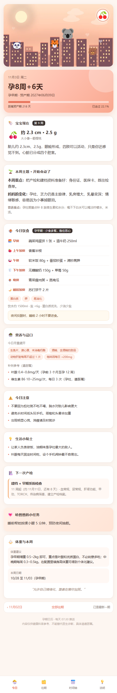
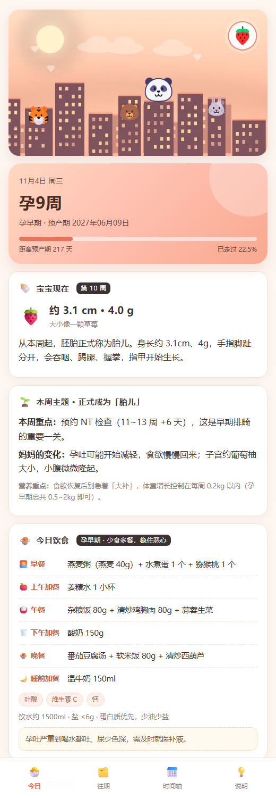
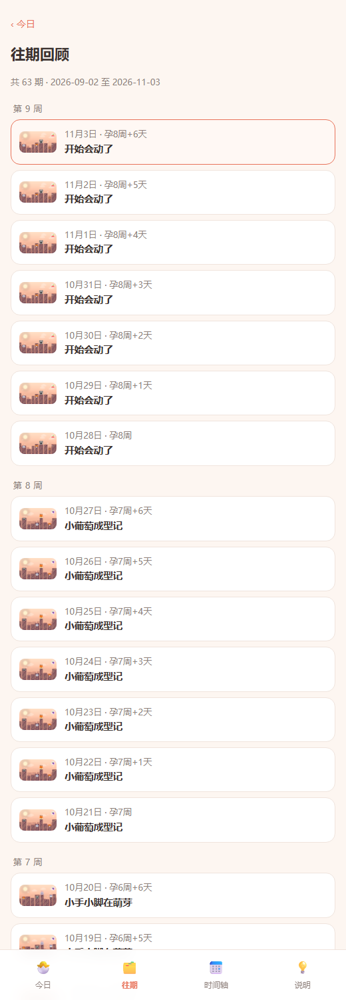

# 孕期日历 · 每日推送

给老婆做的孕期助手：每天早上 07:30，一张有图有内容的卡片，把 **今天孕几周**、宝宝长到多大、今天吃什么、要注意什么、下次产检什么时候，一次讲清楚。

- 末次月经：**2026-09-02** ｜ 预产期：**2027-06-09**
- 今天（2026-11-04）：**孕 9 周**，第 10 周，孕早期，距预产期 217 天
- 在线地址（GitHub Pages）：<https://qirenjie-algo.github.io/pregnancy-daily/>



每一期顶部都有和孕周对应的动态配图：动物城风格的黄昏/夜景天际线，兔子、狐狸、考拉、熊猫、老虎、小熊轮流出场，右上角徽章里是「宝宝大小」的果实（42 张，按孕早/中/晚期换配色）：


线上版本（GitHub Pages，电脑关机也能打开）：<https://qirenjie-algo.github.io/pregnancy-daily/>



---

## 1. 功能一览

| 能力 | 说明 |
| --- | --- |
| 每日推送 | 每天 07:30（可改）推到微信 / iPhone / Telegram / 企微 / 钉钉 / 飞书 |
| 动态高清图 | 42 周 × 动画 WebP（720×405，14 帧循环），动物城天际线 + 霓虹窗 + 动物居民 + 果实徽章 |
| 每日饮食 | 三餐三点，按孕期分池轮换，附营养关键词、忌口清单、补剂参考 |
| 孕期知识 | 40 周胎儿发育、妈妈变化、本周重点、营养重点、小贴士 |
| 科普小课堂 | 19 节课：NT、唐筛、无创、大排畸、糖耐、GBS、胎心监护…把每项检查讲透 |
| 安全提醒 | 每天一条安全注意事项，按孕周过滤，不会「孕早期提醒你待产包」 |
| 今日小技巧 | 每天两条生活小技巧，覆盖吃、睡、行、情绪，按阶段匹配 |
| 注意事项 | 每周 3~4 条 + 阶段提醒（28 周数胎动、36 周待产包…） |
| 产检日程 | 11 项产检自动判断「本周要做 / 下一次 / 还有几天」 |
| 往期回顾 | 每一期都保留，页尾可上一条/下一条/全部往期，推送末尾也有入口 |
| 手机网页 | H5 + PWA，可添加到主屏幕，离线可看 |
| 关机也能推 | GitHub Actions + Pages 云端方案，或 Docker 跑在 NAS/VPS |
| 本地优先 | 纯 Python 标准库，无第三方依赖，数据不外传 |

---

## 2. 快速开始（1 分钟）

需要 Python 3.8+（Windows 装 python.org 版本即可，**不需要 pip install**）。

```bash
cd pregnancy-daily
python app.py check      # 自检：孕周、预产期
python app.py serve      # 启动手机网页 http://127.0.0.1:8787
```

手机连同一 Wi-Fi，打开终端里打印的 `http://192.168.x.x:8787`。

其它命令：

```bash
python app.py today            # 终端直接打印今天的推送
python app.py preview          # 导出静态 HTML 到 out/
python app.py push --dry-run   # 预览推送内容（不发送）
python app.py push             # 正式推送（需先配置通道）
python app.py assets           # 重新生成 42 周动态图（需 Pillow）
python app.py export --out site  # 导出整站（含往期），可部署到 Pages
```

---

## 3. 电脑关机了还能推送吗？

**结论：默认不能，但已经内置了「关机也能推」的云端方案，配置一次就行。**

推送的本质是「到点有一个程序去执行发送」。这个程序跑在哪，决定了电脑关机后还能不能推：

| 跑在哪 | 电脑关机 | 手机离线 | 成本 | 适合 |
| --- | --- | --- | --- | --- |
| 你的电脑（daemon / 任务计划） | ❌ 不推 | — | 0 | 每天开机 |
| **GitHub Actions + Pages** | ✅ 照推 | ✅ 网页也能开 | 免费 | 最省心（推荐） |
| NAS / 软路由 / VPS（Docker） | ✅ 照推 | ✅ | 电费/服务器 | 有常开设备 |
| 手机快捷指令 | ✅ | ❌ | 0 | 不想用云服务 |

### 方案 A：本机运行（电脑开着才推）

```bash
python app.py daemon
```

或注册 Windows 计划任务（`deploy/install-task.ps1`，每天 07:30，错过开机会补跑）：

```powershell
cd pregnancy-daily\deploy
powershell -ExecutionPolicy Bypass -File .\install-task.ps1
```

### 方案 B：GitHub Actions + Pages（**电脑关机也能推**，推荐）

思路：把「生成内容 + 推送 + 网页」都搬到 GitHub 的服务器上，每天 UTC 23:30（北京时间 07:30）自动跑一次。

1. 在 GitHub 新建**私有仓库** `pregnancy-daily`（不要勾选自动生成 README）；
2. 本地推送：

```bash
cd pregnancy-daily
git init
git add .
git commit -m "孕期日历"
git branch -M main
git remote add origin https://github.com/qirenjie-algo/pregnancy-daily.git
git push -u origin main
```

3. 仓库 **Settings → Pages**，Source 选 **GitHub Actions**；
4. 仓库 **Settings → Secrets and variables → Actions**，新建 `PREGNANCY_CONFIG`，内容就是完整的 `config.json`（含各通道密钥）；
5. 仓库 **Actions** 页面启用 `孕期每日推送 · 云端版`，先点 **Run workflow** 手动跑一次验证。

> `config.json` 已在 `.gitignore` 里，推送密钥不会进仓库；云端通过 Secret 注入。
> 如果她的手机打不开 Pages，检查仓库是否 Public，或 Pages 设置里的可见性。

这个工作流会依次：

1. 用 `config.json` 生成当天的静态站点（含 42 周配图、全部往期）；
2. 部署到 GitHub Pages（`https://<用户名>.github.io/<仓库名>/`）；
3. 推送当天卡片，消息里的配图与「往期」链接都指向 Pages，**手机随时能打开**。

> 如果仓库名是 `<用户名>.github.io`，把工作流里的 `PREGNANCY_BASE_URL` 改成 `https://<用户名>.github.io/`。
> 免费额度：私有仓库每月 2000 分钟，这个任务一天约十几秒，完全够用。

### 方案 C：Docker 跑在 NAS / 软路由 / VPS（7×24）

家里有群晖、威联通、树莓派或一台云服务器，用它更稳：

```bash
docker compose up -d --build
```

`docker-compose.yml` 已经挂载了 `config.json` 和 `data/`，容器里同时跑网页（8787）和每日推送。改完配置 `docker compose restart` 生效。

### 方案 D：手机快捷指令（不用服务器，但只能看网页）

iPhone「快捷指令 → 自动化 → 每天 07:30 → 打开 URL」，指向 Pages 地址，到点弹通知打开今日卡片。
不依赖电脑，但推送内容只是一条通知+网页，不如方案 B 完整。

---

## 4. 配置推送通道

编辑 `config.json` 的 `channels`，把要用的通道 `enabled` 改成 `true` 并填凭证；可以配多个，会全部发送。

| 通道 | 适合 | 需要什么 | 费用 |
| --- | --- | --- | --- |
| `serverchan` | 微信服务号推送，最省事 | SendKey | 免费 |
| `pushplus` | 微信推送，支持群组 | Token | 免费 |
| `bark` | iPhone 原生通知 | Key | 免费 |
| `telegram` | 有梯子 / 海外 | Bot Token + Chat ID | 免费 |
| `wecom` | 企业微信群机器人 | Webhook | 免费 |
| `dingtalk` | 钉钉群机器人 | Webhook + 可选加签 | 免费 |
| `feishu` | 飞书群机器人 | Webhook | 免费 |
| `webhook` | 自建服务 / 其它 App | 一个能收 JSON 的 URL | 自定 |

### Server 酱（微信，推荐）

1. 打开 <https://sct.ftqq.com>，微信扫码登录；
2. 「SendKey」页面复制 `SCT` 开头的 Key；
3. 关注「方糖」服务号，推送会出现在会话里。

```json
{ "name": "老婆微信", "type": "serverchan", "enabled": true, "sendkey": "SCTxxxxx" }
```

> Server 酱³（`https://sc3.ft07.com`）加一行 `"endpoint": "https://sc3.ft07.com"`。

### PushPlus（微信）

1. <https://www.pushplus.plus> 微信登录复制 token；
2. 关注公众号「pushplus 推送加」。

```json
{ "name": "我的微信", "type": "pushplus", "enabled": true, "token": "xxxx" }
```

### Bark（iPhone）

App Store 安装 Bark，复制 key（`https://api.day.app/xxxxxxxx` 的最后一段）。

```json
{ "name": "iPhone", "type": "bark", "enabled": true, "key": "xxxxxxxx", "group": "孕期" }
```

### Telegram

@BotFather 建 bot 拿 token，给 bot 发条消息后访问
`https://api.telegram.org/bot<token>/getUpdates` 拿 `chat_id`。

```json
{ "name": "Telegram", "type": "telegram", "enabled": true, "token": "123:ABC", "chat_id": "123456" }
```

### 企业微信 / 钉钉 / 飞书

群聊 → 添加机器人 → 复制 Webhook：

```json
{ "name": "企业微信", "type": "wecom", "enabled": true, "webhook": "https://qyapi.weixin.qq.com/cgi-bin/webhook/send?key=xxx" }
{ "name": "钉钉", "type": "dingtalk", "enabled": true, "access_token": "xxx", "secret": "SECxxx" }
{ "name": "飞书", "type": "feishu", "enabled": true, "webhook": "https://open.feishu.cn/open-apis/bot/v2/hook/xxx" }
```

> 企业微信的 markdown 不渲染图片，程序会自动先发一条**图片消息**（本周配图），再发文字卡片，图文都能看到。
> 其它通道（Server 酱 / PushPlus / Telegram / 飞书）直接用 markdown 图片语法。

配好后先预览再发送：

```bash
python app.py push --dry-run
python app.py push
```

结果记录在 `data/push_log.jsonl`；同一天同一通道默认只发一次（`--force` 强制重发）。

---

## 5. 手机端、动态图与往期

### 5.1 添加到主屏幕（像 App 一样）

- iPhone：Safari 打开 → 分享 → 添加到主屏幕
- Android：Chrome 打开 → 菜单 → 安装应用

网页带 Service Worker，断网也能看最近一次内容。**网页没有登录鉴权，只建议在家庭 Wi-Fi 内使用，不要把 8787 端口映射到公网。**

### 5.2 动态高清图

- 每周一张 **动画 WebP**：720×405、14 帧、约 1 秒循环。双层城市天际线、闪烁的霓虹窗、窗边与屋顶的小动物居民，右上角「宝宝大小」徽章会轻轻呼吸
- 动画细节：窗户随机明灭、动物探头、徽章脉动、星星/云朵漂移
- 按孕期换配色：孕早期黄昏蜜桃、孕中期白天青绿、孕晚期夜晚藕荷
- 风格灵感来自「动物城」，但角色全部是通用动物形象（emoji 渲染），**没有使用任何迪士尼角色素材**，可以放心个人使用
- 图里没有文字，文字由页面排版，任何屏幕都清晰、也能翻译
- 页面用 `` 播放；微信/企微里是一张静态首帧，点开链接看动图
- 重新生成：`python app.py assets --force`（需要 Pillow；Windows 用系统 emoji 字体）
- 想回到原来的水果隐喻风格：`python app.py assets --force --style fruit`

> 生成的素材已随项目提供（`web/assets/`，42 张 WebP + 42 张缩略图，约 3.4MB），部署时不需要 Pillow。

### 5.3 往期回顾

- `/history` 全部往期，按周分组，**每天一期都不会丢**（内容由「日期 + 孕周」确定性生成，不依赖数据库）
- 每一天页面底部：`‹ 前一天 ｜ 全部往期 ｜ 后一天 ›`
- 推送消息末尾同样带 `昨天的卡片 / 全部往期` 链接
- 静态导出时同时生成 `/day/2026-11-03` 与 `/day/2026-11-03.html` 两种地址，便于各种托管



---

## 6. 内容是怎么生成的

### 6.1 孕周引擎

- 预产期 = 末次月经 + 280 天 → **2027-06-09**
- 页面显示临床写法 `孕8周+6天`；内容按「第 N 周」组织（第 9 周 = 孕 8 周 0 天 ~ 8 周 6 天）
- 孕期划分：孕早期 ≤13 周 +6 天，孕中期 14~27 周 +6 天，孕晚期 ≥28 周

> 早孕 B 超与末次月经相差超过 7 天时，医院通常按 B 超校正。改 `config.json` 的 `lmp` 即可，或临时 `python app.py --lmp 2026-09-05 today`。

### 6.2 每日饮食

- 三套菜单池（孕早/中/晚期）各 5 天，`date.toordinal() % 5` 轮换，同一天永远一致
- 固定六餐：早餐 / 上午加餐 / 午餐 / 下午加餐 / 晚餐 / 睡前加餐
- 叠加本周营养关键词（叶酸、铁、钙、DHA、碘、膳食纤维…）
- 每个孕期独立的忌口清单与补剂参考
- 特殊周专项提示：12 周 NT、24 周糖耐、28 周数胎动、36 周待产包…

### 6.3 产检日程

`data/checkups.json` 共 11 项，按 `start_week`/`end_week` 自动判断：

- 落在区间内 → **本周要做的产检**（高亮）
- 还没到 → **下一次产检**，自动算日期和倒计时
- 已过 → 标记完成，不再打扰

### 6.4 孕晚期自动加料

- ≥28 周：每天数胎动（早中晚各 1 小时，×4 ≥ 30 次）
- ≥32 周：散步建议、胎心监护
- ≥36 周：待产包、随时出发提醒

### 6.5 科普小课堂

`data/classroom.json` 里有 19 节课，每节包含：一句话引入、查什么、怎么做、报告怎么看、异常怎么办、小贴士。

- 产检类 11 节：首次 B 超、建档抽血、NT、唐筛、无创 DNA、大排畸、糖耐、孕晚期 B 超、胎心监护、GBS、36 周后每周产检
- 孕期知识 8 节：数胎动、真假宫缩、破水、见红、无痛分娩、脐带绕颈、孕期用药、孕期贫血
- 选择逻辑：优先讲和本周相关（`weeks` 命中）的课，否则在全部课程里按日期轮换

### 6.6 安全提醒与今日小技巧

`data/tips.json` 分 `safety`（14 条）和 `hacks`（24 条），每条可带 `range: [起始周, 结束周]`：

- 每天按日期轮换一条安全提醒、两条小技巧
- 带 `range` 的条目只在对应孕周出现，避免「孕 9 周提醒待产包」这种错位
- 小技巧覆盖饮食、睡眠、出行、情绪、待产准备

### 6.7 个性化

填 `height_cm` / `pre_weight_kg`，按孕前 BMI 给出整个孕期增重区间与每周速度。

---

## 7. 自定义内容

所有内容都在 `data/` 下，改完重启即可。

| 文件 | 内容 |
| --- | --- |
| `data/weeks-1.json` | 第 1~14 周（孕早期） |
| `data/weeks-2.json` | 第 15~27 周（孕中期） |
| `data/weeks-3.json` | 第 28~42 周（孕晚期） |
| `data/meals.json` | 三餐三点菜单池、忌口、补剂、特殊周提示 |
| `data/checkups.json` | 产检日程与频率说明 |
| `data/classroom.json` | 科普小课堂（19 节课） |
| `data/tips.json` | 安全提醒与小技巧（可带适用孕周） |

单周字段：

```json
"9": {
  "title": "开始会动了",
  "baby": "胎儿约 2.3cm…",
  "mom": "孕吐、乏力仍是主旋律…",
  "focus": "把产检和建档资料准备好…",
  "nutrition": "孕吐期重点补 B 族维生素和水分…",
  "precautions": ["…", "…"],
  "tip": "让家人负责做饭…",
  "checkup": "建档 / 早期血检",
  "size": {"len": 2.3, "weight": 2.5, "like": "一颗樱桃"}
}
```

改完记得重生成配图：`python app.py assets --force`（动物按周轮换，果实徽章按 `size.like` 自动匹配）。

`config.json` 字段：`lmp`、`push_time`、`port`、`base_url`（推送链接指向的地址）、`height_cm`、`pre_weight_kg`、`push_image`、`channels`。

---

## 8. 目录结构

```
pregnancy-daily/
├─ app.py                  # 入口：serve / push / daemon / preview / assets / export
├─ config.json             # 你的配置（含推送密钥，别提交）
├─ config.example.json     # 配置模板
├─ pregnancy/
│  ├─ gestation.py         # 孕周、预产期、孕期阶段
│  ├─ content.py           # 每日卡片合成（知识+饮食+产检+往期）
│  ├─ render.py            # 手机 H5 页面
│  ├─ assets.py            # 动态图生成（Pillow）
│  ├─ site.py              # 静态站点导出（GitHub Pages）
│  ├─ push.py              # 8 种推送通道
│  ├─ store.py             # 配置读写、推送日志、当日去重
│  └─ visuals.py           # 图标、孕期配色
├─ data/                   # 40 周知识库、菜单、产检表
├─ web/
│  ├─ assets/              # 42 张动画 WebP + 42 张缩略图
│  ├─ manifest.json / sw.js / icon.svg
├─ deploy/                 # Windows 计划任务、bat、容器启动脚本
├─ tools/check_site.py     # 静态站断链检查
├─ tests/                  # 39 项测试
├─ site/                   # 导出的静态站（git 忽略）
└─ out/                    # preview 产物（git 忽略）
```

---

## 9. 测试与自检

```bash
python -m unittest discover -s tests -v
python tools/check_site.py site     # 导出后检查断链
```

覆盖：预产期/孕周边界、孕期划分、40 周数据完整性、菜单轮换确定性、产检状态、
Markdown（含配图与往期链接）、真实 HTTP 投递与去重、HTTP 路由（首页/API/往期/日页/素材/404）、
往期索引、静态导出与相对路径、断链检查。

---

## 10. 常见问题

**Q：电脑关机还能推吗？**
见第 3 节。要关机也能推，用 GitHub Actions（免费）或 Docker 跑在 NAS/VPS；本机方案需要电脑开机。

**Q：动态图在微信里不动？**
微信聊天里显示的是静态首帧，点开链接进入网页即可看到动画；网页里是循环播放的。

**Q：推送里的图片不显示？**
图片是绝对地址，需要 `base_url` 是公网地址（如 GitHub Pages）。本机 `127.0.0.1` 时程序会自动省略配图。

**Q：怎么改推送时间？**
改 `config.json` 的 `push_time`；GitHub Actions 则改工作流里的 cron（UTC = 北京时间 − 8 小时）。

**Q：预产期和医院算的不一样？**
预产期 = 末次月经 + 280 天。医生按早期 B 超校正过的话，以医生为准，改 `lmp`。

**Q：推送没收到？**
先 `push --dry-run` 看内容，再 `push` 看返回码，失败详情在 `data/push_log.jsonl`。企业微信 markdown 上限 4096 字节，程序会自动裁剪并附链接。

**Q：数据会上传吗？**
不会。全部文件在本地；只有你配置的推送通道会收到卡片内容。

---

## 11. 免责声明

内容为孕期健康科普，参考围产期保健常规整理，**不能替代医生诊断**。
出现阴道出血、腹痛、破水、胎动明显减少、持续头痛或视物模糊，请立即就医。
